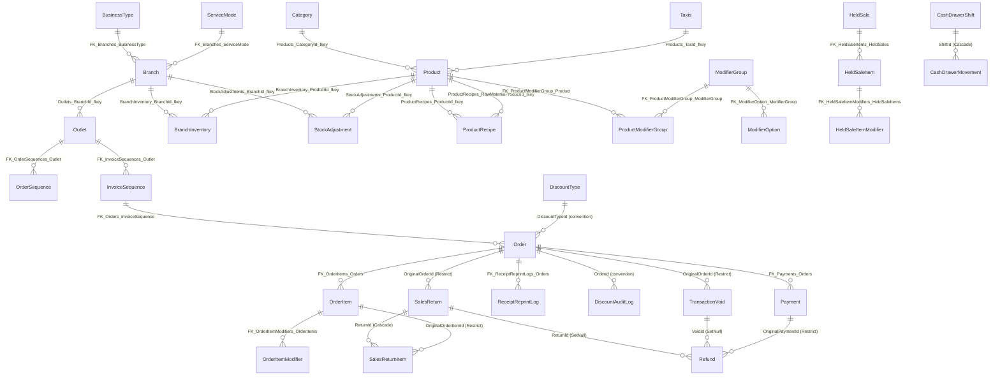

# Pos.Solution — Comprehensive Architecture, Database & Business Logic Review

## 1. Executive Summary

**Pos.Solution** is a multi-project, multi-branch, multi-outlet Point of Sale (POS) and Back-Office Management platform built on **.NET 10.0**. It is designed for Philippine commercial retail and Food & Beverage (F&B) operations with built-in support for **Bureau of Internal Revenue (BIR)** tax and statutory discount compliance (under the National Internal Revenue Code, RA 9994 Expanded Senior Citizens Act, RA 10754 PWD Act, and RA 11976 Ease of Paying Taxes [EOPT] Act).

### Core System Capabilities
1. **Multi-Mode Cashiering (`POS.Client` — .NET MAUI Blazor Hybrid):**
   - Dynamically adapts its cashier interface based on the branch's `BusinessType`:
     - **Food & Beverage (F&B) Mode:** Category tile grid, visual product cards, required/optional product modifier groups (`ModifierGroup` / `ModifierOption`), kitchen item flags, and service modes (`Dine-In`, `Take-Out`, `Delivery`).
     - **Retail / Supermarket Mode:** High-density tabular line-item entry, barcode/SKU/short-code scanning, and function-key shortcuts (`F2`, `F4`, `F8`, `F9`, `F12`).
   - Supports **Offline-First Operation** backed by a local SQLite database (`LocalPosDbContext`) with background reference data synchronization (`ReferenceDataSyncService`), local cash checkout and BIR invoice issuance (`OfflineCheckoutService`), and an outbox pattern (`LocalSyncOutbox` + `OfflineTransactionSyncService`) with exponential backoff and jitter.
2. **Centralized REST API (`POS.Api` — ASP.NET Core Web API + PostgreSQL):**
   - Manages 38 entities in PostgreSQL (`PosDbContext`), handling order creation, split and single-tender payment processing, row-locked per-outlet sequence generation (`OrderSequences` and BIR `InvoiceSequences`), statutory and promotional discount calculations (`DiscountCalculationService`), receipt generation and controlled reprint auditing (`ReceiptService`), held/parked sales (`HeldSalesController`), returns/refunds/voids (`ReturnsController`), cash drawer shifts (`CashDrawerController`), and cashier session handoffs (`CashierSessionsController`).
3. **Back-Office Administration Portal (`POS.Web` — Blazor Web App / Interactive Server):**
   - AdminLTE 4 / Bootstrap 5 management interface for branches, POS registers/outlets, BIR invoice series, product catalog, recipes/Bill of Materials (BOM), modifier groups, branch inventory ledgers, discount rules, users/PINs, held sales, returns/voids audit, transaction history, and financial sales reporting.
4. **Shared Contracts & Client SDK (`POS.Shared` — .NET 10 Class Library):**
   - Houses 39 DTO models, 20 service interfaces, typed `HttpClient` service wrappers, deterministic product short-code generation (`ProductShortCodeGenerator`), and shared offline/online BIR tax and discount calculation logic (`LocalDiscountCalculationService`).

### Architectural Readiness Summary
While the functional surface area is broad and the BIR tax/statutory discount domain modeling is well-researched (`docs/BIR_RESEARCH.md`), **the system currently contains critical production blockers** across security, financial/inventory consistency, schema management, and client compilation:
- **Compile-breaking errors** exist in `POS.Client/Components/Pages/NewSale.razor` (`isOffline`, `Cart.TotalAmount`, `OrderResponseDto.OrderDate`) and `POS.Client/Data/LocalPosModels.cs`.
- **Online orders never deduct inventory or consume product recipes (BOM)**, and **online cash payments/refunds never update open cash drawer shifts** (only offline sync performs stock deduction and cash drawer updates).
- **Critical security vulnerabilities** include 18+ unauthenticated API controllers, `[AllowAnonymous]` overrides on void/return endpoints coupled with a supervisor approval check that accepts a bare username without a PIN/password, plaintext PIN storage exposed via `GET api/Users`, and hardcoded database/JWT credentials in source control.
- **Database migration fragmentation** across 4 incompatible mechanisms (EF Core Power Tools reverse-engineered `PosDbContext.cs`, hand-edited `PosDbContext.Extensions.cs`, a startup `MigrationRunner.cs` referencing deleted/missing `.sql` files, and an unused SQL Server `ApplicationDbContext` in `POS.Web`).

---

## 2. Database Architecture & Data Models

### 2.1 Multi-Database Topology

| Project | DbContext Class | Database Engine | Provider NuGet | Storage / Connection Details | Actual Role in System |
| :--- | :--- | :--- | :--- | :--- | :--- |
| **`POS.Api`** | `PosDbContext` | **PostgreSQL** (`pos_db`) | `Npgsql.EntityFrameworkCore.PostgreSQL` `10.0.3` | `Host=localhost;Port=5432;Database=pos_db;...` (`Npgsql.EnableLegacyTimestampBehavior = true`) | Primary authoritative relational store (38 `DbSet`s). |
| **`POS.Client`** | `LocalPosDbContext` | **SQLite** (`local_pos.db`) | `Microsoft.EntityFrameworkCore.Sqlite` `10.0.0` | `%LocalAppData%\PosSolution\local_pos.db` (`PRAGMA journal_mode=WAL; PRAGMA synchronous=NORMAL; PRAGMA foreign_keys=OFF;`) | Offline-first terminal cache for reference catalog, local orders/payments, and sync outbox (14 `DbSet`s). |
| **`POS.Web`** | `ApplicationDbContext` | **SQL Server LocalDB** | `Microsoft.EntityFrameworkCore.SqlServer` `10.0.8` | `Server=(localdb)\mssqllocaldb;Database=aspnet-POS_Web-...` | Unused scaffolded ASP.NET Core Identity schema (8 tables). Actual `POS.Web` login uses `CustomAuthStateProvider` against `POS.Api`. |

---

### 2.2 Entity-Relationship Diagram (`POS.Api` — PostgreSQL `PosDbContext`)



---

### 2.3 Complete PostgreSQL Table, Primary Key, Foreign Key & Index Reference (`PosDbContext`)

#### A. Organization, Terminal & Sequence Tables
| Entity / Table | Primary Key | Foreign Keys & Delete Behavior | Unique Constraints & Indexes | Notes / Architectural Observations |
| :--- | :--- | :--- | :--- | :--- |
| **`BusinessType`** (`"BusinessType"`) | `Id` (`int`, `"id"`) | — | `UX_BusinessType_type` (Unique on `"type"`) | Classifies branch UI (`Food & Beverage`, `Retail`, etc.). |
| **`ServiceMode`** (`"ServiceMode"`) | `ServiceModeId` (`int`, `"id"`) | — | — | `Dine-In`, `Take-Out`, `Delivery`. Column casing mismatch between `applied_service_mode.sql` (`type`) and EF (`"Type"`). |
| **`Branch`** (`"Branches"`) | `BranchId` (`int`) | `BusinessTypeId` (`int?`) -> `BusinessType.Id` (`Restrict`)<br>`ServiceModeId` (`int?`) -> `ServiceMode.ServiceModeId` (`SetNull`) | `IX_Branches_BusinessTypeId` | Stores `TaxType` (`VAT-Registered` vs `Non-VAT`), `Tin`, and `TrackInventory`. |
| **`Outlet`** (`"Outlets"`) | `OutletId` (`int`) | `BranchId` (`int`) -> `Branch.BranchId` (`Cascade`) | — | Represents a POS terminal/register (`DeviceIdentifier`, `TerminalName`, `MachineIdentificationNumber`, `PermitToUseNumber`, `TerminalSerialNumber`). |
| **`OrderSequence`** (`"OrderSequences"`) | `OrderSequenceId` (`int`, `"order_sequence_id"`) | `OutletId` (`int`, `"outlet_id"`) -> `Outlet.OutletId` (`Cascade`) | `outlet_id` `UNIQUE` in SQL (missing `.IsUnique()` in EF) | Operational order counter per outlet (`{CodePrefix}-{LastIssuedNumber:D6}`). Locked with `FOR UPDATE`. |
| **`InvoiceSequence`** (`"InvoiceSequences"`) | `InvoiceSequenceId` (`int`, `"invoice_sequence_id"`) | `OutletId` (`int`, `"outlet_id"`) -> `Outlet.OutletId` (`Cascade`) | — | Legal BIR invoice series (`SeriesCode`, `Prefix`, `StartingNumber`, `LastIssuedNumber`, `EndingNumber`, `PaddingLength`, `IsActive`). Locked with `FOR UPDATE`. |
| **`User`** (`"Users"`) | `UserId` (`int`) | — | `Users_Username_key` (Unique on `Username`) | Stores BCrypt `PasswordHash`, `Role` (`Admin`, `Manager`, `Senior Cashier`, `Cashier`), and **plaintext `PinCode`** (`varchar(10)`). |

#### B. Catalog, Modifiers, Recipes & Inventory Tables
| Entity / Table | Primary Key | Foreign Keys & Delete Behavior | Unique Constraints & Indexes | Notes / Architectural Observations |
| :--- | :--- | :--- | :--- | :--- |
| **`Category`** (`"Categories"`) | `CategoryId` (`int`) | — | `CK_Categories_ColorHex` check constraint | Soft-deletable (`IsDeleted`, `IsActive`), `ColorHex` (`varchar(7)`, default `#2563EB`). |
| **`Taxis`** (`"Taxes"`) | `TaxId` (`int`) | — | — | `Name` (`VATable`, `VAT-Exempt`, `Zero-Rated`), `Rate`. |
| **`UnitOfMeasure`** (`"UnitOfMeasures"`) | `UomId` (`int`) | — | — | `Name`, `Symbol` (`pcs`, `kg`, `ml`). Standalone lookup; `Product.UnitOfMeasure` stores string rather than FK. |
| **`Product`** (`"Products"`) | `ProductId` (`int`) | `CategoryId` (`int`) -> `Category.CategoryId` (`ClientSetNull`)<br>`TaxId` (`int?`) -> `Taxis.TaxId` (`SetNull`) | — | Supports `Standard`, `MadeToOrder`, `RawMaterial` (`ProductType`), `ShortCode` (`varchar(4)`), `Barcode`, `Sku`, `IsKitchenItem`, `IsDeleted`. |
| **`ProductRecipe`** (`"ProductRecipes"`) | `RecipeId` (`int`) | `ProductId` (`int`) -> `Product.ProductId` (`Cascade`)<br>`RawMaterialProductId` (`int`) -> `Product.ProductId` (`ClientSetNull`) | `UQ_Product_Ingredient` (Unique on `ProductId, RawMaterialProductId`) | Defines BOM ingredient quantities (`QuantityRequired`, `Uom`). **Never consumed during order/payment processing.** |
| **`ModifierGroup`** (`"ModifierGroup"`) | `ModifierGroupId` (`int`, `"modifier_group_id"`) | — | — | `IsRequired`, `MinSelections`, `MaxSelections`, `DisplayOrder`, `IsActive`. |
| **`ModifierOption`** (`"ModifierOption"`) | `ModifierOptionId` (`int`, `"modifier_option_id"`) | `ModifierGroupId` (`int`, `"modifier_group_id"`) -> `ModifierGroup.ModifierGroupId` (`Cascade`) | — | Individual add-on/choice (`Name`, `Price`, `DisplayOrder`, `IsActive`). |
| **`ProductModifierGroup`** (`"ProductModifierGroup"`) | `ProductModifierGroupId` (`int`, `"product_modifier_group_id"`) | `ProductId` (`int`, `"product_id"`) -> `Product.ProductId` (`Cascade`)<br>`ModifierGroupId` (`int`, `"modifier_group_id"`) -> `ModifierGroup.ModifierGroupId` (`Cascade`) | `UQ_Product_ModifierGroup` (Unique on `ProductId, ModifierGroupId`) | Links products to modifier groups with `DisplayOrder`. |
| **`BranchInventory`** (`"BranchInventory"`) | `BranchInventoryId` (`int`) | `BranchId` (`int`) -> `Branch.BranchId` (`Cascade`)<br>`ProductId` (`int`) -> `Product.ProductId` (`Cascade`) | `UQ_Branch_Product` (Unique on `BranchId, ProductId`) | Tracks `StockQuantity` (`int`), `ReorderLevel` (`int`), `LastUpdated`. |
| **`StockAdjustment`** (`"StockAdjustments"`) | `StockAdjustmentId` (`int`) | `BranchId` (`int`) -> `Branch.BranchId` (`ClientSetNull`)<br>`ProductId` (`int`) -> `Product.ProductId` (`ClientSetNull`) | — | Ledger of stock changes (`AdjustmentType`, `Quantity`, `PreviousQuantity`, `NewQuantity`, `Reason`, `CreatedAt`). |

#### C. Sales, Payments, Discounts & Audit Tables
| Entity / Table | Primary Key | Foreign Keys & Delete Behavior | Unique Constraints & Indexes | Notes / Architectural Observations |
| :--- | :--- | :--- | :--- | :--- |
| **`Order`** (`"Orders"`) | `OrderId` (`long`) | `InvoiceSequenceId` (`int?`, `"invoice_sequence_id"`) -> `InvoiceSequence.InvoiceSequenceId` (`SetNull`)<br>`DiscountTypeId` (`int?`) -> `DiscountType.DiscountTypeId` (by convention) | `Orders_OrderNumber_key` (Unique on `OrderNumber`)<br>`IX_Orders_InvoiceNumber` (Unique on `InvoiceNumber`) | **No FKs** on `BranchId`, `OutletId`, `ShiftId`, or `CashierId`. Captures BIR tax breakdown (`VatableSales`, `VatExemptSales`, `ZeroRatedSales`, `VatAmount`) and customer BIR fields. |
| **`OrderItem`** (`"OrderItems"`) | `OrderItemId` (`long`) | `OrderId` (`long`) -> `Order.OrderId` (`Cascade`) | — | Snapshot pattern: stores `ProductId`, `ProductName`, `ProductShortCode`, `Quantity`, `BasePrice`, `ModifierTotal`, `UnitPrice`, `LineTotal`, `DiscountAmount`, `VatType`, `VatAmount` without FK to `Product`. |
| **`OrderItemModifier`** (`"OrderItemModifiers"`) | `OrderItemModifierId` (`long`) | `OrderItemId` (`long`) -> `OrderItem.OrderItemId` (`Cascade`) | — | Snapshot pattern: stores `ModifierOptionId`, `ModifierName`, `AdditionalPrice` without FK to `ModifierOption`. |
| **`Payment`** (`"Payments"`) | `PaymentId` (`long`) | `OrderId` (`long`) -> `Order.OrderId` (`Cascade`) | — | Supports split payments (`PaymentMethod`, `Amount`, `AmountTendered`, `ChangeAmount`, `ReferenceNumber`, `PaymentStatus`, `ProcessedBy`, `PaidAt`). |
| **`PaymentMethod`** (`"PaymentMethods"`) | `PaymentMethodId` (`int`, `"payment_method_id"`) | — | `PaymentMethods_code_key` (Unique on `"code"`) | `CASH`, `CARD`, `GCASH`, `MAYA`, etc. (`RequiresReference`, `IsActive`, `DisplayOrder`). |
| **`DiscountType`** (`"DiscountTypes"`) | `DiscountTypeId` (`int`) | — | `Code` `UNIQUE` in SQL (missing in EF) | **Missing from `OnModelCreatingPartial`** in `PosDbContext.Extensions.cs`; relies on DataAnnotations. |
| **`DiscountAuditLog`** (`"DiscountAuditLogs"`) | `AuditId` (`long`) | `OrderId` (`long?`) -> `Order.OrderId` (`SetNull` in SQL, convention in EF) | — | **Missing from `OnModelCreatingPartial`** in `PosDbContext.Extensions.cs`. Logs statutory/manual discount usage (`DiscountCode`, `DiscountPercentage`, `DiscountAmount`, `CustomerName`, `CustomerIdNumber`, `ApprovedBy`, `AppliedBy`). |
| **`ReceiptReprintLog`** (`"ReceiptReprintLogs"`) | `ReprintLogId` (`long`) | `OrderId` (`long`) -> `Order.OrderId` (`Cascade`) | `IX_ReceiptReprintLogs_OrderId`<br>`IX_ReceiptReprintLogs_ReprintedAt` | Immutable audit trail for BIR receipt reprints (`ReprintedBy`, `ReprintedAt`, `TerminalInfo`, `Reason`). |

#### D. Held Sales, Returns/Voids, Cash Drawer, Shifts & Offline Sync Tables
| Entity / Table | Primary Key | Foreign Keys & Delete Behavior | Unique Constraints & Indexes | Notes / Architectural Observations |
| :--- | :--- | :--- | :--- | :--- |
| **`HeldSale`** (`"HeldSales"`) | `HeldSaleId` (`long`) | — | `HeldSales_HoldReference_key` (Unique on `HoldReference`) | Parked cart header (`HELD`, `RESUMED`, `CANCELLED`, `EXPIRED`). No FKs on `BranchId`, `OutletId`, `CashierId`. |
| **`HeldSaleItem`** (`"HeldSaleItems"`) | `HeldSaleItemId` (`long`) | `HeldSaleId` (`long`) -> `HeldSale.HeldSaleId` (`Cascade`) | — | Parked line items. |
| **`HeldSaleItemModifier`** (`"HeldSaleItemModifiers"`) | `HeldSaleItemModifierId` (`long`) | `HeldSaleItemId` (`long`) -> `HeldSaleItem.HeldSaleItemId` (`Cascade`) | — | Parked line item modifiers. |
| **`HeldSaleAuditLog`** (`"HeldSaleAuditLogs"`) | `AuditId` (`long`) | — | — | Logs `HELD`, `RESUMED`, `CANCELLED` actions. |
| **`TransactionVoid`** (`"TransactionVoids"`) | `VoidId` (`long`) | `OriginalOrderId` (`long`) -> `Order.OrderId` (`Restrict`) | — | Full transaction cancellation record (`ReasonCategory`, `RequestedBy`, `ApprovedBy`, `Status`, `ReversalReference`). |
| **`SalesReturn`** (`"SalesReturns"`) | `ReturnId` (`long`) | `OriginalOrderId` (`long`) -> `Order.OrderId` (`Restrict`) | — | Partial or full return header (`ReturnNumber`, `TotalRefundAmount`, `Reason`, `RequestedBy`, `ApprovedBy`, `Status`). |
| **`SalesReturnItem`** (`"SalesReturnItems"`) | `ReturnItemId` (`long`) | `ReturnId` (`long`) -> `SalesReturn.ReturnId` (`Cascade`)<br>`OriginalOrderItemId` (`long`) -> `OrderItem.OrderItemId` (`Restrict`) | — | Returned item quantities, prorated tax/discount, and `RestockDisposition` (`RESTOCK`, `DEFECTIVE`, `WASTE`). |
| **`Refund`** (`"Refunds"`) | `RefundId` (`long`) | `ReturnId` (`long?`) -> `SalesReturn.ReturnId` (`SetNull`)<br>`VoidId` (`long?`) -> `TransactionVoid.VoidId` (`SetNull`)<br>`OriginalPaymentId` (`long`) -> `Payment.PaymentId` (`Restrict`) | — | Disbursement record (`RefundMethod`, `RefundAmount`, `ReferenceNumber`, `ProcessedBy`, `RefundedAt`). |
| **`CashierSession`** (`"CashierSessions"`) | `CashierSessionId` (`long`) | — | — | Tracks active cashier terminal ownership (`ACTIVE`, `SWITCHED_OUT`, `LOGGED_OUT`, `PreviousSessionId`). |
| **`CashierSwitchLog`** (`"CashierSwitchLogs"`) | `SwitchLogId` (`long`) | — | — | Audit log for cashier handoffs (`PreviousCashierId`, `NewCashierId`, `ActionType`, `SwitchedAt`). |
| **`CashDrawerShift`** (`"CashDrawerShifts"`) | `ShiftId` (`long`) | — | — | Tracks physical drawer float and reconciliation (`OpeningFloat`, `TotalCashSales`, `TotalCashRefunds`, `TotalCashIn`, `TotalCashOut`, `ExpectedBalance`, `ActualCountedBalance`, `Discrepancy`). |
| **`CashDrawerMovement`** (`"CashDrawerMovements"`) | `MovementId` (`long`) | `ShiftId` (`long`) -> `CashDrawerShift.ShiftId` (`Cascade`) | — | Tracks `CASH_IN`, `CASH_OUT`, `CASH_SALE` drawer movements. |
| **`OfflineSyncIdempotencyRecord`** (`"OfflineSyncIdempotency"`) | `SyncId` (`long`) | — | `UX_OfflineSync_LocalTx` (`LocalTransactionId`)<br>`UX_OfflineSync_Invoice` (`InvoiceNumber`) | Defined in `OfflineSyncModels.cs` and `PosDbContext.Extensions.cs:370-377`, **but never queried or inserted by `OfflineSyncController.cs`!** |

---

### 2.4 Decimal Precision & Scale Audit (Currency, Tax, Discounts & Inventory)

A critical requirement in POS and BIR accounting systems is deterministic decimal precision across currency (`numeric(18,2)`), tax/discount rates (`numeric(18,4)` / `numeric(5,2)`), and inventory/recipe quantities (`numeric(18,3)` / `numeric(18,4)`). Across `POS.Api`, `POS.Client`, and SQL scripts, precision configuration is inconsistent:

| Entity / Table | Column / Property | C# Type | `POS.Api` EF Configuration | PostgreSQL SQL Script | `POS.Client` SQLite Model | Audit Finding / Risk |
| :--- | :--- | :--- | :--- | :--- | :--- | :--- |
| **`Taxis` (`Taxes`)** | `Rate` | `decimal?` (API) / `decimal` (Client) | **`.HasPrecision(18)` (NO SCALE)** (`PosDbContext.cs:186`) | Scaffolded | `[Column(TypeName = "decimal(18,4)")]` | **CRITICAL BUG:** `.HasPrecision(18)` with no second argument maps to `numeric(18,0)` in PostgreSQL, truncating fractional tax rates (e.g., `0.12` -> `0`) if EF creates/validates the schema! |
| **`Order`** | `Subtotal`, `DiscountAmount`, `TotalAmount` | `decimal` | `.HasPrecision(18, 2)` | `NUMERIC(18,2)` | `[Column(TypeName = "decimal(18,2)")]` | Properly configured (`18,2`). |
| **`Order`** | `VatableSales`, `VatExemptSales`, `ZeroRatedSales`, `VatAmount` | `decimal` | **UNCONFIGURED** in `Order.cs` & `PosDbContext.Extensions.cs` | `NUMERIC(18,2)` (`DiscountModule.sql`) | `[Column(TypeName = "decimal(18,2)")]` | **Missing EF Precision:** Relies on external SQL script; unconfigured in EF model. |
| **`Order`** | `DiscountPercentage` | `decimal` | **UNCONFIGURED** in `Order.cs` & `PosDbContext.Extensions.cs` | `NUMERIC(5,2)` (`DiscountModule.sql`) | *(Omitted in `LocalOrder`)* | **Missing EF Precision** (`5,2`) and missing in `LocalOrder`. |
| **`OrderItem`** | `Quantity` | `decimal` (API) / **`int`** (Client) | `.HasPrecision(18, 3)` | `NUMERIC(18,3)` | **`int`** (`LocalPosModels.cs:171`) | **Type Mismatch:** API supports fractional quantities (`18,3` for weighted items like `kg`), but `LocalOrderItem.Quantity` and `OfflineTransactionItemDto.Quantity` are `int`! |
| **`OrderItem`** | `BasePrice`, `ModifierTotal`, `UnitPrice`, `LineTotal` | `decimal` | `.HasPrecision(18, 2)` | `NUMERIC(18,2)` | `UnitPrice`, `LineTotal`: `decimal(18,2)` | Properly configured (`18,2`), though `BasePrice` and `ModifierTotal` are missing on `LocalOrderItem`. |
| **`OrderItem`** | `DiscountAmount`, `VatAmount` | `decimal` | **UNCONFIGURED** in `OrderItem.cs` & `PosDbContext.Extensions.cs` | `NUMERIC(18,2)` (`DiscountModule.sql`) | *(Omitted in `LocalOrderItem`)* | **Missing EF Precision** in `POS.Api` and omitted from `LocalOrderItem`. |
| **`OrderItemModifier`** | `AdditionalPrice` | `decimal` | `.HasPrecision(18, 2)` | `NUMERIC(18,2)` | *(Table missing in Client)* | Properly configured in API; table completely absent in `LocalPosDbContext`. |
| **`Payment`** | `Amount`, `AmountTendered`, `ChangeAmount` | `decimal` | `.HasPrecision(18, 2)` | `NUMERIC(18,2)` | `[Column(TypeName = "decimal(18,2)")]` | Properly configured (`18,2`). |
| **`Product`** | `Price`, `CostPrice` | `decimal`, `decimal?` | `.HasPrecision(18, 2)` | `numeric(18,2)` | `decimal` (**unconfigured**, `CostPrice` non-nullable) | `LocalProduct.CostPrice` is non-nullable `decimal` while `Product.CostPrice` is `decimal?`. |
| **`Product`** | `UnitValue` | `decimal?` | `.HasPrecision(10, 2)` | `numeric(10,2)` | `decimal?` (**unconfigured**) | Unconfigured precision in `LocalProduct`. |
| **`ProductRecipe`** | `QuantityRequired` | `decimal` | `.HasPrecision(18, 4)` | `numeric(18,4)` | *(Not in Client)* | `18,4` precision in recipe BOM, **but see `BranchInventory` below**. |
| **`BranchInventory`** | `StockQuantity`, `ReorderLevel` | **`int`** | Default `integer` | `integer` | *(Not in Client)* | **CRITICAL ARCHITECTURE FLAW:** Stock is stored as `int` while `ProductRecipe.QuantityRequired` is `decimal(18,4)` and `OrderItem.Quantity` is `decimal(18,3)`. Fractional recipe consumption (e.g., `0.0500 kg` of coffee beans) or weighted retail items cannot be deducted from `int` stock! |
| **`StockAdjustment`** | `Quantity`, `PreviousQuantity`, `NewQuantity` | **`int`** | Default `integer` | `integer` | *(Not in Client)* | Same `int` limitation as `BranchInventory`. |
| **`DiscountType`** | `DiscountValue` | `decimal` | `[Column(TypeName = "numeric(18,4)")]` (attribute only) | `NUMERIC(18,4)` | `[Column(TypeName = "decimal(18,2)")]` | Scale mismatch: `(18,4)` in API vs `(18,2)` in `LocalDiscount`. |
| **`HeldSale` / `HeldSaleItem` / `HeldSaleItemModifier`** | Monetary & `Quantity` columns | `decimal` | `.HasColumnType("numeric(18,2)")` / `numeric(18,3)` | *(SQL script missing from disk)* | *(Not in Client)* | Configured in Fluent API (`PosDbContext.Extensions.cs:291-313`). |
| **`SalesReturn` / `SalesReturnItem` / `Refund`** | Monetary & `Quantity` columns | `decimal` | `.HasColumnType("numeric(18,2)")` / `numeric(18,3)` | *(SQL script missing from disk)* | *(Not in Client)* | Configured in Fluent API (`PosDbContext.Extensions.cs:316-349`). |
| **`CashDrawerShift` / `CashDrawerMovement`** | Monetary columns | `decimal` / `decimal?` | `[Column(TypeName = "numeric(18,2)")]` + `.HasColumnType("numeric(18,2)")` | *(SQL script missing from disk)* | *(Not in Client)* | Configured in both DataAnnotations and Fluent API. |

---

## 3. Core Modules & Business Logic

### 3.1 Cashiering, Cart Management & Sequence Numbering
1. **Cart State (`POS.Client/Services/CartService.cs:1-162`):**
   - Maintains an in-memory list of `CartItem` objects. When adding a product (`AddItem`), `CartService` checks whether an item with the same `ProductId` and identical sorted set of `ModifierOptionId`s already exists (`AreModifiersEqual`, `L116-127`); if so, it increments `Quantity`.
   - Computes `CartItem.UnitPrice = BasePrice + SelectedModifiers.Sum(m => m.Price)` and `CartItem.LineTotal = UnitPrice * Quantity`.
   - Holds active discount metadata (`ActiveDiscountCode`, `ActiveDiscountName`, `ActiveDiscountAmount`, `CustomerCardNumber`).
2. **Order Creation (`POS.Api/Controllers/OrdersController.cs:16-149`):**
   - `POST api/Orders` opens a database transaction, generates an operational `OrderNumber` via `ISequenceService.GenerateOrderNumberAsync(dto.OutletId)`, looks up the branch's `TaxType` (`VAT-Registered` by default), and invokes `IDiscountCalculationService.CalculateOrder(calcReq)`.
   - Persists the `Order` (`OrderStatus = "PENDING"`, `PaymentStatus = "UNPAID"`), `OrderItem`s, and `OrderItemModifier`s.
   - If `calcRes.DiscountAmount > 0`, inserts a `DiscountAuditLog` record (`L125-138`) before committing.
3. **Dual Sequence Architecture (`POS.Api/Services/SequenceService.cs:1-118`):**
   - **Operational Order Number (`GenerateOrderNumberAsync`, `L9-72`):** Issued at order creation (`PENDING`/`UNPAID`). Uses `SELECT * FROM "OrderSequences" WHERE "outlet_id" = {0} FOR UPDATE` to lock the outlet's row, auto-creating one with `CodePrefix = "POS{outletId:D2}"` if absent, and formats `{CodePrefix}-{LastIssuedNumber:D6}` (e.g., `POS01-000001`).
   - **Legal BIR Invoice Number (`IssueInvoiceNumberAsync`, `L74-117`):** Issued **only upon full payment completion** (`PaymentsController.cs:125`) to prevent gaps in BIR-registered invoice sequences from abandoned or unpaid carts. Locks the active `InvoiceSequences` row via `SELECT * FROM "InvoiceSequences" WHERE "outlet_id" = {0} AND "is_active" = true FOR UPDATE`, verifies `LastIssuedNumber < EndingNumber`, increments `LastIssuedNumber`, formats `{Prefix}{LastIssuedNumber.ToString().PadLeft(PaddingLength, '0')}`, and stamps `InvoiceSequenceId`, `InvoiceNumber`, and `InvoiceIssuedAt` onto `Order`.
4. **Held / Parked Sales (`POS.Api/Controllers/HeldSalesController.cs:14-239`):**
   - `POST api/held-sales` parks an active cart under a generated `HoldReference` (`HOLD-yyMMddHHmmss-RRR`) with `Status = "HELD"` and writes a `HELD` entry to `HeldSaleAuditLogs`.
   - `POST api/held-sales/{id}/resume` runs under `IsolationLevel.Serializable` (`L134`), verifies the sale is still `HELD` (`409 Conflict` if already resumed by another terminal) and matches the requesting `outletId` (`403 Forbid`), transitions `Status = "RESUMED"`, and logs `RESUMED`.

---

### 3.2 Payment Processing (`POS.Api/Controllers/PaymentsController.cs:16-162`)
1. **Idempotency / Double-Payment Guard:** Rejects with `409 Conflict` if `order.PaymentStatus == "PAID"` (`L26-27`).
2. **Split Tender Mode (`L34-76`):**
   - Accepts multiple `PaymentSplitDto` entries (e.g., partial `CASH` + partial `GCASH`).
   - Validates that `Math.Abs(totalSplitAmount - order.TotalAmount) <= 0.01m` (`L37-41`), each split has `Amount > 0`, and `AmountTendered >= Amount`, calculating `ChangeAmount = tendered - split.Amount` per split.
3. **Single Tender Mode (`L77-105`):**
   - Validates `tendered >= order.TotalAmount`, computes `change = tendered - totalAmount`, and inserts a single `Payment` record with `PaymentStatus = "SUCCESS"`.
4. **Order Completion & BIR Invoice Issuance (`L107-128`):**
   - Updates optional customer BIR invoice fields (`CustomerName`, `CustomerAddress`, `CustomerTin`, `CustomerBusinessStyle`).
   - Verifies total `SUCCESS` payments cover `order.TotalAmount - 0.01m`, transitions `order.PaymentStatus = "PAID"` and `order.OrderStatus = "COMPLETED"`, and calls `sequenceService.IssueInvoiceNumberAsync(order.OrderId, order.OutletId)` inside the same transaction.

---

### 3.3 Discounts & BIR Tax / VAT Compliance (`DiscountCalculationService.cs`, `LocalDiscountCalculationService.cs`, `docs/BIR_RESEARCH.md`)
Both `POS.Api/Services/DiscountCalculationService.cs` and `POS.Shared/Services/LocalDiscountCalculationService.cs` implement identical line-by-line BIR tax and statutory discount formulas:
1. **Gross Line Calculation (`L25-26`):**
   - $\text{EffectiveUnitPrice} = \text{UnitPrice} + \text{ModifierTotal}$
   - $\text{LineGross} = \text{Round}(\text{EffectiveUnitPrice} \times \text{Quantity}, 2)$
2. **Baseline Tax Classification (`L40-66`):**
   - If `TaxName` contains `"EXEMPT"` -> `VatExemptSales = LineGross`, `VatType = "EXEMPT"`.
   - If `TaxName` contains `"ZERO"` -> `ZeroRatedSales = LineGross`, `VatType = "ZERO_RATED"`.
   - Otherwise, if branch is `"VAT-Registered"`:
     - $\text{VatableSales} = \text{Round}(\text{LineGross} / 1.12, 2)$
     - $\text{VatAmount} = \text{Round}(\text{LineGross} - \text{VatableSales}, 2)$
     - `VatType = "VATABLE"`.
   - If branch is `"Non-VAT"` -> `VatExemptSales = LineGross`, `VatType = "NON_VAT"`.
3. **Statutory & Promotional Discount Rules (`L69-114`):**
   - **`SC` (Senior Citizen), `PWD` (Person with Disability), `NAAC` (National Athletes & Coaches), `MOV` (Medal of Valor):**
     - On a `VAT-Registered` branch for a `VATABLE` item (`L71-82`), removes 12% VAT first per RA 9994 / RR 7-2010 and RA 10754 / RR 5-2017:
       $$\text{VAT-Exclusive Base (GSP)} = \text{Round}\left(\frac{\text{LineGross}}{1.12}, 2\right)$$
       $$\text{DiscountAmount} = \text{Round}(\text{GSP} \times 0.20, 2)$$
       $$\text{LineTotal (Net Payable)} = \text{Round}(\text{GSP} - \text{DiscountAmount}, 2)$$
       Reclassifies the line from `VATABLE` to `EXEMPT` (`VatAmount = 0`, `VatableSales = 0`, `VatExemptSales = GSP`).
     - On a `Non-VAT` branch or already `EXEMPT` item (`L83-88`), applies 20% directly off `LineGross`.
   - **`SP` (Solo Parent):** Applies 10% discount off `LineGross` (`L89-94`).
   - **`BNPC` (Basic Necessities & Prime Commodities):** Applies 5% discount off `LineGross` (`L95-100`).
   - **`EMPLOYEE`:** Applies 10% discount off `LineGross` (`L101-105`).
   - **`MANUAL`:** Applies `request.ManualDiscountPercentage`% off `LineGross` (`L106-110`).
4. **Order-Level BIR Aggregation (`L131-140`):**
   - `VatableSales`: Sum of `(LineTotal - VatAmount)` across `VATABLE` items.
   - `VatExemptSales`: Sum of `(LineTotal + DiscountAmount)` across `EXEMPT` and `NON_VAT` items (recording the full VAT-exclusive GSP as VAT-Exempt Sales per RR 7-2010).
   - `ZeroRatedSales`: Sum of `LineTotal` across `ZERO_RATED` items.
   - `VatAmount`: Sum of `VatAmount` across all items.

---

### 3.4 Inventory Deductions & Recipe BOM Consumption
1. **Manual Inventory Management (`POS.Api/Controllers/InventoryController.cs:14-127`):**
   - `GET api/Inventory/branch/{branchId}` lists stock per branch (and auto-seeds missing `BranchInventory` rows with `StockQuantity = 0, ReorderLevel = 5`).
   - `POST api/Inventory/adjust` processes manual stock movements (`"add"`, `"deduct"`, `"set"`), clamping quantities at `0`, updating `BranchInventory.StockQuantity`, and recording a `StockAdjustment` audit row (`L111-123`).
2. **Offline Sale Sync Stock Deduction (`POS.Api/Controllers/OfflineSyncController.cs:107-129`):**
   - When an offline transaction is uploaded to `POST api/offline-sync/transactions`, the controller looks up `BranchInventory` for `(request.BranchId, itemDto.ProductId)`, subtracts `itemDto.Quantity` (`Math.Max(0, prevQty - itemDto.Quantity)`), and writes a `StockAdjustment` row with `AdjustmentType = "OFFLINE_SALE_SYNC"`.
3. **Return Restocking (`POS.Api/Controllers/ReturnsController.cs:353-363`):**
   - During `POST api/Returns`, if an item's `RestockDisposition` is `"RESTOCK"`, `inventory.StockQuantity += (int)Math.Round(itemReq.Quantity)` is executed (without writing a `StockAdjustment` log).
4. **Missing Online Sale & Recipe BOM Deductions (Critical Gap):**
   - Neither `OrdersController.CreateOrder` nor `PaymentsController.ProcessPayment` touches `BranchInventories` or `StockAdjustments`. **Online sales do not deduct inventory at all.**
   - `ProductRecipesController.cs` provides CRUD for `ProductRecipes` (`MadeToOrder` product -> `RawMaterial` ingredients), **but `ProductRecipes` is never queried or deducted anywhere in the order, payment, or offline sync pipelines.**

---

### 3.5 Audit Logs, Returns, Voids, Cash Drawer & Receipt Reprints
1. **Controlled Receipt Reprints (`ReceiptsController.cs:15-56`, `TransactionsController.cs:235-278`, `ReceiptService.cs:10-89`):**
   - `ReceiptService.GetReceiptAsync` verifies that `order.PaymentStatus == "PAID"` and `SUCCESS` payments cover `order.TotalAmount`.
   - When `reprint=true`, the API executes a raw SQL `INSERT INTO "ReceiptReprintLogs"` recording `OrderId`, `ReprintedBy` (`User.Identity.Name`), `ReprintedAt`, `TerminalInfo`, and `Reason = "CONTROLLED_REPRINT"`.
2. **Transaction Voids & Partial/Full Returns (`POS.Api/Controllers/ReturnsController.cs:19-418`):**
   - Both `POST api/Returns/void` and `POST api/Returns` execute inside `IsolationLevel.Serializable` transactions (`L26`, `L255`) and require supervisor authorization (`Admin`, `Manager`, `Senior Cashier`).
   - **Void:** Inserts `TransactionVoid`, marks `order.OrderStatus = "VOIDED"` and `order.PaymentStatus = "VOIDED"`, marks all `SUCCESS` payments `"REFUNDED"`, and creates `Refund` records.
   - **Return:** Validates cumulative returned quantities per `OriginalOrderItemId` across all `COMPLETED` `SalesReturns` (`L310-329`) to prevent over-refunding, prorates line total/tax/discount, inserts `SalesReturn` + `SalesReturnItem`s + `Refund`, and optionally restocks `BranchInventory`.
3. **Cash Drawer Shifts & Cashier Sessions (`CashDrawerController.cs:13-134`, `CashierSessionsController.cs:13-122`):**
   - `CashDrawerController` manages shift opening (`OpeningFloat`), manual cash movements (`CASH_IN`, `CASH_OUT`), and shift closing (`ActualCountedBalance` vs `ExpectedBalance` -> `Discrepancy`).
   - `CashierSessionsController` tracks active cashier terminal sessions and writes `CashierSwitchLogs` when cashiers switch or log out.

---

## 4. Tech Stack & Project Structure

### 4.1 Technology Stack Summary

| Layer | Project | Target Framework | Key Frameworks & NuGet Libraries |
| :--- | :--- | :--- | :--- |
| **Backend API** | `POS.Api` | `net10.0` | ASP.NET Core Web API, EF Core `10.0.12`, `Npgsql.EntityFrameworkCore.PostgreSQL` `10.0.3`, `Microsoft.AspNetCore.Authentication.JwtBearer` `10.0.12`, `BCrypt.Net-Next` `4.2.0`, `Microsoft.AspNetCore.OpenApi` `10.0.12`, `Scalar.AspNetCore` `2.18.0` |
| **POS Terminal Client** | `POS.Client` | `net10.0-windows10.0.19041.0`, `net10.0-android`, `net10.0-ios`, `net10.0-maccatalyst` | .NET MAUI Blazor Hybrid (`Microsoft.AspNetCore.Components.WebView.Maui`), `Microsoft.EntityFrameworkCore.Sqlite` `10.0.0`, `CurrieTechnologies.Razor.SweetAlert2` `5.6.0`, `Microsoft.AspNetCore.Components.QuickGrid` `10.0.12`, `System.Drawing.Printing` (Windows thermal receipt printing) |
| **Back-Office Web Admin** | `POS.Web` | `net10.0` | Blazor Web App (Interactive Server, `prerender: false`), AdminLTE v4.10.0, Bootstrap 5, `CurrieTechnologies.Razor.SweetAlert2` `5.6.0`, `Microsoft.AspNetCore.Components.QuickGrid` `10.0.12`, `Microsoft.AspNetCore.Identity.EntityFrameworkCore` `10.0.8`, `Microsoft.EntityFrameworkCore.SqlServer` `10.0.8` |
| **Shared Contracts & SDK** | `POS.Shared` | `net10.0` | Pure .NET 10 BCL (`System.Net.Http.Json`, `System.ComponentModel.DataAnnotations`) |

---

### 4.2 Repository Folder Hierarchy

```text
Pos.Solution/
├── Pos.Solution.slnx                        # .NET XML Solution file (4 projects)
├── docs/
│   └── BIR_RESEARCH.md                      # Philippine BIR tax, EOPT & statutory discount specification
├── POS.Shared/                              # Shared DTOs, Interfaces, HTTP Services & Calculators
│   ├── Helpers/
│   │   └── CategoryColor.cs                 # Color palette validation & normalization
│   ├── Interfaces/                          # 20 service contracts (IOrderService, IPaymentService, etc.)
│   ├── Models/                              # 39 DTO files (Order, Payment, Receipt, Discount, OfflineSync, etc.)
│   └── Services/                            # 18 HttpClient services + LocalDiscountCalculationService + ProductShortCodeGenerator
├── POS.Api/                                 # ASP.NET Core 10 REST API (PostgreSQL)
│   ├── Controllers/                         # 30 API Controllers (Orders, Payments, Discounts, Returns, OfflineSync, etc.)
│   ├── Models/                              # PosDbContext + 28 domain model files (38 DbSets)
│   │   ├── PosDbContext.cs                  # Core EF Core context (10 reverse-engineered entities)
│   │   ├── PosDbContext.Extensions.cs       # Partial context extending 27 entities (Orders, Payments, Returns, etc.)
│   │   └── PosDbContext.ServiceMode.cs      # Partial context for ServiceModes DbSet
│   ├── Services/                            # Backend domain services
│   │   ├── DiscountCalculationService.cs    # Server-side BIR tax & discount calculation engine
│   │   ├── ReceiptService.cs                # Receipt payload builder & payment verification
│   │   ├── SalesReportService.cs            # Financial aggregation & grouping engine
│   │   └── SequenceService.cs               # Row-locked OrderNumber & BIR InvoiceNumber generator
│   ├── MigrationRunner.cs                   # Startup raw SQL runner (references missing Database/*.sql files)
│   ├── efpt.config.json                     # EF Core Power Tools configuration
│   └── Program.cs                           # DI registration, JWT Bearer config, CORS, Scalar OpenAPI
├── POS.Client/                              # .NET MAUI Blazor Hybrid Cashier Terminal App
│   ├── Components/
│   │   ├── Layout/                          # MainLayout.razor (connectivity/sync status), NavMenu.razor, AuthLayout.razor
│   │   └── Pages/                           # Login, Home, NewSale, DiscountModal, HeldSales, Transactions, CashDrawer, ReceiptPreview
│   ├── Data/
│   │   ├── LocalPosDbContext.cs             # SQLite DbContext (WAL mode, 14 DbSets)
│   │   └── LocalPosModels.cs                # Local SQLite entity definitions
│   ├── Platforms/Windows/
│   │   └── WindowsReceiptPrinter.cs         # 80mm GDI+ PrintDocument thermal printer + HTML browser fallback
│   ├── Services/                            # CartService, PosSessionService, OfflineCheckoutService, OfflineTransactionSyncService, etc.
│   ├── Workers/
│   │   └── OfflineBackgroundSyncWorker.cs   # Unregistered duplicate background sync worker
│   └── MauiProgram.cs                       # MAUI host builder & DI container registration
└── POS.Web/                                 # Blazor Interactive Server Back-Office Admin App
    ├── Auth/
    │   └── CustomAuthStateProvider.cs       # ProtectedSessionStorage JWT authentication provider
    ├── Components/
    │   ├── Account/                         # Unused scaffolded ASP.NET Core Identity pages
    │   ├── Layout/                          # AdminLTE MainLayout.razor, NavMenu.razor
    │   └── Pages/                           # 16 Admin pages (ManageProducts, ManageBranches, ManageInventory, SalesReports, etc.)
    ├── Data/                                # Unused SQL Server ApplicationDbContext & Identity migration
    └── Program.cs                           # Blazor Server setup, HttpClient SSL bypass, dual auth registration
```

---

## 5. Identified Technical Debts, Risks & Bottlenecks

### 5.1 Critical Build & Runtime Blockers (P0)
1. **Compile-Breaking Errors in `POS.Client`:**
   - [`POS.Client/Components/Pages/NewSale.razor`](file:///c:/Users/yaser/source/repos/Pos.Solution/POS.Client/Components/Pages/NewSale.razor#L1226-L1237) and [`L1337`](file:///c:/Users/yaser/source/repos/Pos.Solution/POS.Client/Components/Pages/NewSale.razor#L1337) reference an undeclared variable `isOffline`, a non-existent property `Cart.TotalAmount` (`CartService` only exposes `Subtotal`, `Total`, and `ActiveDiscountAmount`), and a non-existent property `OrderResponseDto.OrderDate` (`OrderResponseDto` exposes `CreatedAt`).
   - [`POS.Client/Data/LocalPosModels.cs`](file:///c:/Users/yaser/source/repos/Pos.Solution/POS.Client/Data/LocalPosModels.cs#L1) includes `using Microsoft.Build.Tasks.Deployment.Bootstrapper;`, which fails compilation on non-Windows/MAUI targets.
2. **Thread-Unsafe Singleton `LocalPosDbContext` in `POS.Client`:**
   - [`POS.Client/MauiProgram.cs`](file:///c:/Users/yaser/source/repos/Pos.Solution/POS.Client/MauiProgram.cs#L39) registers `LocalPosDbContext` as a **Singleton**. It is accessed concurrently by `OfflineBackgroundSyncManager` (30s background timer), `MainLayout.razor` (15s `System.Threading.Timer` callback on thread pool), `Home.razor` (15s timer), and UI components (`NewSale.razor`, `HeldSales.razor`), causing EF Core concurrency exceptions (`A second operation was started on this context instance before a previous operation completed`).
3. **Broken Startup Database Migration Pipeline (`MigrationRunner.cs`):**
   - [`POS.Api/MigrationRunner.cs`](file:///c:/Users/yaser/source/repos/Pos.Solution/POS.Api/MigrationRunner.cs#L15-L23) attempts to read 7 SQL files from `Database/*.sql` using a relative path and a hardcoded connection string. In the working tree, `POS.Api/Database/*.sql` files are deleted/missing, causing `MigrationRunner.Run()` to throw `DirectoryNotFoundException` on every startup (silently swallowed in [`POS.Api/Program.cs`](file:///c:/Users/yaser/source/repos/Pos.Solution/POS.Api/Program.cs#L66-L73)).
4. **Nullable `.Value` Dereferences Causing 500 Crashes:**
   - [`POS.Api/Controllers/ProductsController.cs`](file:///c:/Users/yaser/source/repos/Pos.Solution/POS.Api/Controllers/ProductsController.cs#L42) and [`POS.Api/Controllers/OfflineReferenceDataController.cs`](file:///c:/Users/yaser/source/repos/Pos.Solution/POS.Api/Controllers/OfflineReferenceDataController.cs#L51) evaluate `CostPrice = p.CostPrice.Value` on nullable `decimal? Product.CostPrice`. Any product with `NULL` `CostPrice` crashes `GET api/Products` and `GET api/offline/reference-data`.
   - [`POS.Api/Controllers/TaxesController.cs`](file:///c:/Users/yaser/source/repos/Pos.Solution/POS.Api/Controllers/TaxesController.cs#L19) evaluates `Rate = t.Rate.Value` on nullable `decimal? Taxis.Rate`.
   - [`POS.Api/Controllers/TransactionsController.cs`](file:///c:/Users/yaser/source/repos/Pos.Solution/POS.Api/Controllers/TransactionsController.cs#L164) calls `await receiptService.GetReceiptAsync(id, false)` inside `GetTransactionById`, which throws `InvalidOperationException` whenever a user clicks on an `UNPAID` or `VOIDED` transaction in Transaction History!

---

### 5.2 Critical Security Vulnerabilities (P0)
1. **Supervisor Approval Bypass on Voids and Returns (Username-Only Check):**
   - [`POS.Api/Controllers/ReturnsController.cs`](file:///c:/Users/yaser/source/repos/Pos.Solution/POS.Api/Controllers/ReturnsController.cs#L20) (`POST api/Returns/void`), [`L249`](file:///c:/Users/yaser/source/repos/Pos.Solution/POS.Api/Controllers/ReturnsController.cs#L249) (`POST api/Returns`), and [`POS.Api/Controllers/TransactionsController.cs`](file:///c:/Users/yaser/source/repos/Pos.Solution/POS.Api/Controllers/TransactionsController.cs#L281) (`POST api/Transactions/{id}/void`) are decorated with `[AllowAnonymous]`.
   - Worse, [`ReturnsController.cs`](file:///c:/Users/yaser/source/repos/Pos.Solution/POS.Api/Controllers/ReturnsController.cs#L42-L44) and [`L271-L273`](file:///c:/Users/yaser/source/repos/Pos.Solution/POS.Api/Controllers/ReturnsController.cs#L271-L273) verify supervisor approval via:
     ```csharp
     approver = await context.Users
         .SingleOrDefaultAsync(u => u.PinCode == cleanPin || u.Username.ToLower() == cleanPin.ToLower(), cancellationToken);
     ```
     Passing `"admin"` (or any manager's username) in `ApprovedByPinOrUsername` bypasses PIN authentication completely and approves any void or refund.
2. **Unauthenticated Endpoints Across 18+ Controllers & Full PIN Dump:**
   - [`POS.Api/Controllers/UsersController.cs`](file:///c:/Users/yaser/source/repos/Pos.Solution/POS.Api/Controllers/UsersController.cs#L10-L34) has no `[Authorize]` attribute and returns every user's `Username`, `Role`, and plaintext `PinCode` on `GET api/Users`, and allows unauthenticated user creation/deletion.
   - `OrdersController`, `PaymentsController`, `OfflineSyncController`, `DiscountsController`, `InventoryController`, `ProductsController`, `ProductRecipesController`, `CategoriesController`, `BranchesController`, `OutletsController` (CRUD actions), `BusinessTypesController`, `ModifierGroupsController`, `ModifierOptionsController`, `ProductModifiersController`, `PaymentMethodsController`, `ServiceModesController`, `TaxesController`, `UomsController`, and `EndpointsController` lack `[Authorize]` attributes.
3. **Permanent Cashier-to-Supervisor Privilege Escalation on Terminal:**
   - In [`POS.Client/Components/Pages/Transactions.razor`](file:///c:/Users/yaser/source/repos/Pos.Solution/POS.Client/Components/Pages/Transactions.razor#L373-L380), when a supervisor enters their PIN to authorize a cashier's receipt reprint, line `380` overwrites `Http.DefaultRequestHeaders.Authorization` with the supervisor's Bearer token and never restores the cashier's token (`Session.Token`).
4. **Hardcoded Credentials, Secrets & Production TLS Bypass:**
   - PostgreSQL password (`p@$$w0rd`) and JWT secret (`BjQYAiIS5mfYIw296Obh8sTtvMtdfPl2`) are hardcoded in [`POS.Api/Models/PosDbContext.cs`](file:///c:/Users/yaser/source/repos/Pos.Solution/POS.Api/Models/PosDbContext.cs#L40), [`POS.Api/MigrationRunner.cs`](file:///c:/Users/yaser/source/repos/Pos.Solution/POS.Api/MigrationRunner.cs#L11), and [`POS.Api/appsettings.json`](file:///c:/Users/yaser/source/repos/Pos.Solution/POS.Api/appsettings.json#L10-L13).
   - [`POS.Web/Program.cs`](file:///c:/Users/yaser/source/repos/Pos.Solution/POS.Web/Program.cs#L56) disables TLS certificate validation (`ServerCertificateCustomValidationCallback = ... => true`) unconditionally in all environments.

---

### 5.3 Core Business Logic, Financial & Inventory Bugs (P1)
1. **Online Sales Never Deduct Inventory or Consume Recipe BOMs:**
   - [`POS.Api/Controllers/OrdersController.cs`](file:///c:/Users/yaser/source/repos/Pos.Solution/POS.Api/Controllers/OrdersController.cs) and [`POS.Api/Controllers/PaymentsController.cs`](file:///c:/Users/yaser/source/repos/Pos.Solution/POS.Api/Controllers/PaymentsController.cs) never decrement `BranchInventory` or create `StockAdjustment` entries.
   - `ProductRecipes` (`MadeToOrder` BOM ingredients) are never consumed anywhere in online or offline sales processing.
   - `BranchInventory.StockQuantity` and `StockAdjustment.Quantity` are `int`, making fractional recipe deductions (`decimal(18,4)`) or weighted product deductions (`decimal(18,3)`) impossible without schema alteration.
2. **Online Cash Sales & Refunds Never Update Cash Drawer Shifts:**
   - [`POS.Api/Controllers/PaymentsController.cs`](file:///c:/Users/yaser/source/repos/Pos.Solution/POS.Api/Controllers/PaymentsController.cs) and [`POS.Api/Controllers/ReturnsController.cs`](file:///c:/Users/yaser/source/repos/Pos.Solution/POS.Api/Controllers/ReturnsController.cs) never update `CashDrawerShift.TotalCashSales`, `TotalCashRefunds`, `ExpectedBalance`, or `CashDrawerMovements`. Only `OfflineSyncController.cs:150-174` updates `ExpectedBalance` (while forgetting to increment `TotalCashSales`).
3. **Over-Refunding Undiscounted Gross Price on Discounted Orders:**
   - [`POS.Api/Controllers/OrdersController.cs`](file:///c:/Users/yaser/source/repos/Pos.Solution/POS.Api/Controllers/OrdersController.cs#L95-L109) stores the **undiscounted** gross amount (`unitPrice * itemDto.Quantity`) in `OrderItem.LineTotal`.
   - [`POS.Api/Controllers/ReturnsController.cs`](file:///c:/Users/yaser/source/repos/Pos.Solution/POS.Api/Controllers/ReturnsController.cs#L332-L333) calculates `unitRefundPrice = orderItem.LineTotal / orderItem.Quantity`, causing returns on discounted orders (e.g., 20% SC/PWD + 12% VAT exempt) to refund the full undiscounted price, exceeding what the customer actually paid!
4. **Duplicate `ProductId` Line-Item Corruption in Order & Offline Checkout:**
   - Both [`POS.Api/Controllers/OrdersController.cs`](file:///c:/Users/yaser/source/repos/Pos.Solution/POS.Api/Controllers/OrdersController.cs#L98) and [`POS.Client/Services/OfflineCheckoutService.cs`](file:///c:/Users/yaser/source/repos/Pos.Solution/POS.Client/Services/OfflineCheckoutService.cs#L139) match calculated item results via `calcRes.CalculatedItems.FirstOrDefault(ci => ci.ProductId == itemDto.ProductId)`. When a cart has two lines with the same `ProductId` (e.g., same drink with different modifiers), both lines receive the first line's tax/discount/total values.
5. **Client-Trusted Pricing & Hardcoded Statutory Discount Eligibility:**
   - `OrdersController.CreateOrder` (`L39-42`) trusts `BasePrice`, `AdditionalPrice`, and `TaxName` sent by the client instead of querying authoritative values from `Products` and `ModifierOptions`, and hardcodes `IsEligibleForStatutoryDiscount = true` for all items.
   - `DiscountCalculationService` and `LocalDiscountCalculationService` hardcode discount codes (`SC`, `PWD`, `NAAC`, `MOV`, `SP`, `BNPC`, `EMPLOYEE`, `MANUAL`) and ignore custom discount rules created in `DiscountTypes` via `ManageDiscounts.razor`.
6. **Broken Offline Checkout Sequence & Missing Offline Modifiers:**
   - [`POS.Client/Services/ReferenceDataSyncService.cs`](file:///c:/Users/yaser/source/repos/Pos.Solution/POS.Client/Services/ReferenceDataSyncService.cs) and [`POS.Api/Controllers/OfflineReferenceDataController.cs`](file:///c:/Users/yaser/source/repos/Pos.Solution/POS.Api/Controllers/OfflineReferenceDataController.cs) never sync `InvoiceSequences` to `LocalPosDbContext.InvoiceSequences`, causing `OfflineCheckoutService` (`L42-45, 65-71`) to always fail with `"Offline invoice sequence exhausted"`.
   - When offline orders sync to `OfflineSyncController.cs`, the server does not advance `InvoiceSequences.LastIssuedNumber` and ignores `OfflineSyncIdempotencyRecord`, risking invoice number collisions with online sales.
   - `LocalOrderItem` has no modifier storage, silently dropping all item modifiers on offline orders.
   - `OfflineTransactionSyncService.cs:29, 111-112` queries `SyncOutboxes.AsNoTracking()` and then mutates `outboxItem.Status = "UPLOADING"`, which EF Core ignores on `SaveChangesAsync()`.
7. **Sales Reporting & Transaction Summary Bugs:**
   - [`POS.Shared/Services/TransactionServices.cs`](file:///c:/Users/yaser/source/repos/Pos.Solution/POS.Shared/Services/TransactionServices.cs#L88-L96) (`SalesReportApiService.GenerateReportAsync`) forgets to pass `request.DateFrom` in the query string.
   - [`POS.Api/Controllers/TransactionsController.cs`](file:///c:/Users/yaser/source/repos/Pos.Solution/POS.Api/Controllers/TransactionsController.cs#L318-L338) (`GetTransactionSummary`) accepts `dateFrom` but never applies it to the LINQ query.
   - [`POS.Api/Services/SalesReportService.cs`](file:///c:/Users/yaser/source/repos/Pos.Solution/POS.Api/Services/SalesReportService.cs#L18-L55) does not deduct `SalesReturns` from `GrossSales`/`NetSales`/`OutputVat` and misattributes split payments when filtering by `PaymentMethod`.

---

### 5.4 Concurrency, Data Integrity & Performance Bottlenecks (P2)
1. **Race Conditions on Payments, Inventory & Cash Drawer:**
   - `PaymentsController.ProcessPayment` (`L19-30`) reads `order.PaymentStatus` outside the database transaction without `FOR UPDATE`, allowing concurrent double-payment requests to succeed.
   - `InventoryController.AdjustStock`, `OfflineSyncController.SyncTransaction`, `ReturnsController.ProcessReturn`, and `CashDrawerController.RecordMovement` read-modify-write balances without row-level locking (`FOR UPDATE`) or concurrency tokens.
2. **Database Schema & Precision Drift:**
   - `Taxis.Rate` has `.HasPrecision(18)` (scale `0`) in `PosDbContext.cs:186`.
   - `Order` VAT columns (`VatableSales`, `VatExemptSales`, `ZeroRatedSales`, `VatAmount`, `DiscountPercentage`) and `OrderItem` (`DiscountAmount`, `VatAmount`) have no precision configured in EF Core.
   - `DiscountType` and `DiscountAuditLog` are omitted from `PosDbContext.Extensions.cs`.
3. **Silent Error Swallowing & Corrupt Fallback in Web Admin (`POS.Web`):**
   - `ProductService.cs:26-41` and `CategoryService.cs:26-42` do not call `EnsureSuccessStatusCode()` on `PUT`/`DELETE`.
   - `ManageProducts.razor:901-914` falls back to picking `allProds.MaxBy(p => p.ProductId)` when product creation fails (`ProductId == 0`), overwriting modifier groups on an existing product!
   - `ManageBranches.razor:237, 578, 666` binds the "Track Inventory" toggle to an unused `isTrackInventoryEnabled` field that never updates `currentBranch.TrackInventory`.
4. **Full-Table Memory Materialization & Duplicate Queries:**
   - `SalesReportService.cs:38`, `ManageProducts.razor:749`, `ManageInventory.razor:309`, and `POS.Web/Components/Pages/Home.razor:177-180` pull entire unpaginated tables into memory before filtering/aggregating.
   - `ManageProducts.razor:724, 742` triggers `LoadProducts()` twice on initial render (`OnInitializedAsync` and `OnParametersSetAsync`).
   - `CategoriesController.cs:34` executes a correlated N+1 `Count()` subquery per category that includes soft-deleted products (`!p.IsDeleted` missing).
   - `InventoryController.cs:20-46` mutates database state (`SaveChangesAsync` seeding `BranchInventory` rows) inside an HTTP `GET` endpoint.
   - Three duplicate background sync workers exist in `POS.Client` (`OfflineBackgroundSyncManager.cs`, `OfflineBackgroundSyncWorker.cs`, `OfflineSyncWorker.cs`), and `OfflineBackgroundSyncManager` never acquires the `IOfflineSyncCoordinator` lease during sync cycles.

---

## 6. Petty Cash & Cash Movement Management Module

### 6.1 Database Schema (PostgreSQL & SQLite)
Rather than creating a duplicate cash movement ledger, the existing `CashDrawerShifts` and `CashDrawerMovements` tables are extended and paired with `CashMovementCategories`:
- **`CashMovementCategories`** (`POS.Api/Models/CashDrawerModels.cs`, `LocalCashMovementCategories` in SQLite):
  - `CategoryId` (PK), `Name` (unique per `MovementType`), `Description`, `MovementType` (`PETTY_CASH`, `CASH_OUT`, `CASH_IN`, `CASH_DROP`), `RequiresApproval` (`bool`), `ApprovalThreshold` (`numeric(18,2)`), `IsActive`, `CreatedAt`.
  - Seeded defaults: *Store Supplies / Petty Cash*, *Emergency Ingredient Purchase*, *Delivery / Rider Fee*, *Utility / Maintenance Expense*, *Additional Change Float (Paid-In)*, *Safe Cash Drop / Skim*, *Miscellaneous Paid-Out*.
- **`CashDrawerShifts`** (`LocalCashDrawerShifts` in SQLite):
  - Added `TotalCashDrops` (`numeric(18,2)`) alongside `OpeningFloat`, `TotalCashSales`, `TotalCashRefunds`, `TotalCashIn`, `TotalCashOut`, `ExpectedBalance`, `ActualCountedBalance`, and `Discrepancy`.
- **`CashDrawerMovements`** (`LocalCashDrawerMovements` in SQLite):
  - Extended with `BranchId`, `OutletId`, `CategoryId` (FK), `CategoryName`, `ReferenceNumber` (`PCV-`, `CIN-`, `COU-`, `CDP-`, `REV-`), `ClientMovementId` (unique idempotency key), `Status` (`PENDING_APPROVAL`, `POSTED`, `REJECTED`, `REVERSED`), `CreatedBy`, `ApprovedBy`, `ApprovedAt`, `PostedAt`, `RejectionReason`, `ReversedBy`, `ReversedAt`, `ReversalReason`, `OriginalMovementId`.

### 6.2 Shift Reconciliation Formula & BIR Isolation
- **Expected Cash Drawer Balance:**
  $$\text{ExpectedBalance} = \text{OpeningFloat} + \text{TotalCashSales} - \text{TotalCashRefunds} + \text{TotalCashIn} - \text{TotalCashOut} - \text{TotalCashDrops}$$
- **Strict Status Filtering:** Only movements with `Status == "POSTED"` affect `TotalCashIn`, `TotalCashOut`, `TotalCashDrops`, or `ExpectedBalance`. `PENDING_APPROVAL` and `REJECTED` movements never alter drawer balances.
- **Online Sales & Refunds Integration:** `PaymentsController.ProcessPayment` increments `TotalCashSales` and `ExpectedBalance` on active shifts for `CASH` payments; `ReturnsController` (`VoidOrder` and `ProcessReturn`) increments `TotalCashRefunds` and decrements `ExpectedBalance` for `CASH` refunds.
- **BIR & Revenue Isolation:** Petty cash and cash drawer movements never create `Orders`, never consume `InvoiceSequences`, and never alter `GrossSales`, `VatableSales`, `VatExemptSales`, `ZeroRatedSales`, `OutputVat`, or `NetSales` in `SalesReportService`. Vouchers are explicitly labeled as internal non-fiscal Cash Movement Vouchers.

### 6.3 Backend API Endpoints (`POS.Api/Controllers/CashDrawerController.cs`)
- `GET / POST / PUT / DELETE api/cash-drawer/categories`: Manage cash movement categories.
- `POST api/cash-drawer/open-shift`, `GET api/cash-drawer/current`, `GET api/cash-drawer/shifts`, `GET api/cash-drawer/shifts/{shiftId}/totals`, `POST api/cash-drawer/close-shift`: Shift lifecycle and reconciliation summary (blocks shift close if `PENDING_APPROVAL` movements remain).
- `POST api/cash-drawer/paid-in`, `POST api/cash-drawer/paid-out`, `POST api/cash-drawer/movement`: Atomic (`IsolationLevel.Serializable`), idempotent (`ClientMovementId`) movement creation with active-shift, ownership, `Amount > 0`, and available drawer cash (`Amount <= shift.ExpectedBalance`) guards.
- `POST api/cash-drawer/movements/{movementId}/approve`, `POST .../reject`, `POST .../reverse`: Supervisor PIN (`u.PinCode == cleanPin` only—never username) or role-based approval, rejection, and immutable reversal (`REVERSAL` entry linked via `OriginalMovementId`).
- `GET api/cash-drawer/movements`, `GET api/cash-drawer/movements/{movementId}`, `GET api/cash-drawer/reports/summary`: Filtered movement history, details, and category breakdown report.

### 6.4 POS.Client & Offline Mode (`POS.Client/Components/Pages/CashDrawer.razor`)
- Full cashier UI supporting Petty Cash, Cash Paid-Out, Cash Paid-In, Safe Cash Drop, confirmation modal, duplicate submission lock, supervisor PIN entry, and printable 58mm/80mm Cash Movement Voucher.
- **Offline Persistence & Sync:**
  - `ReferenceDataSyncService` syncs `LocalCashMovementCategories` and `LocalCashDrawerShifts`.
  - When offline, `CashDrawer.razor` verifies supervisor PINs against cached SHA-256 `LocalCashiers.PinHash` (`Admin`, `Manager`, `Supervisor`, `Senior Cashier`). Unverified approval-required requests are stored as `PENDING_APPROVAL` without reducing local drawer balance.
  - Queued in `LocalSyncOutbox` (`EntityType = "CASH_MOVEMENT"`) and synchronized by `OfflineTransactionSyncService` to `POST api/offline-sync/cash-movements` (`OfflineSyncController.SyncCashMovement`) with server-side idempotency, `SupervisorPinHash` re-verification, `409 Conflict` detection (`FAILED_CONFLICT`), and bounded exponential backoff (`OfflineRetryPolicy`).

### 6.5 POS.Web Admin (`POS.Web/Components/Pages/CashMovementsManagement.razor`)
- Route `/cash-movements` providing Category CRUD, Movement History with Branch/Outlet/Cashier/Type/Status/Category/Date filters, Pending Approval queue, Reversal & Audit Trail, Voucher viewer, and Summary Reports.

### 6.6 Security Controls & Known Limitations
- **Security Controls:** Strict PIN-only supervisor verification (`u.PinCode == cleanPin`), SHA-256 `PinHash` offline verification, server-side shift ownership and drawer balance enforcement, immutable posted records with reversal audit trails.
- **Known Limitations:** Offline shifts opened while completely disconnected (`ShiftId < 0`) require shift synchronization or an active server shift on the outlet before offline cash movements can attach to a server `ShiftId`.
